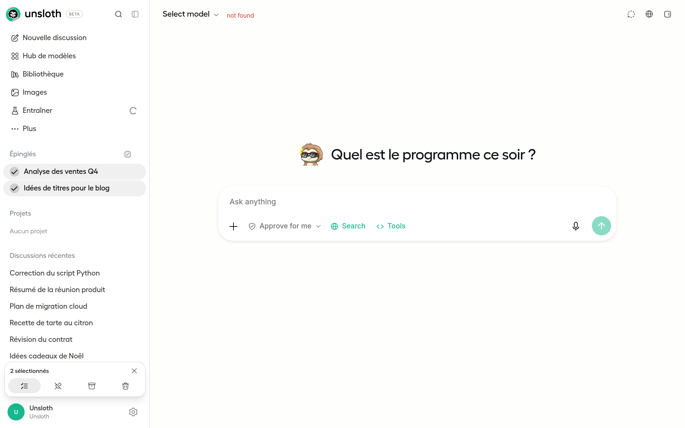
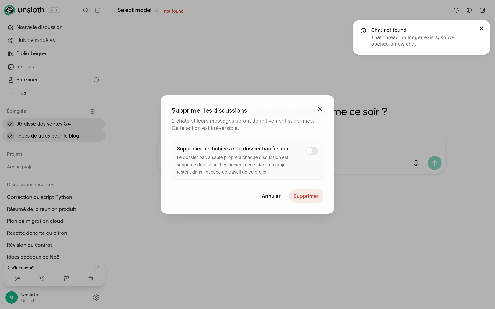
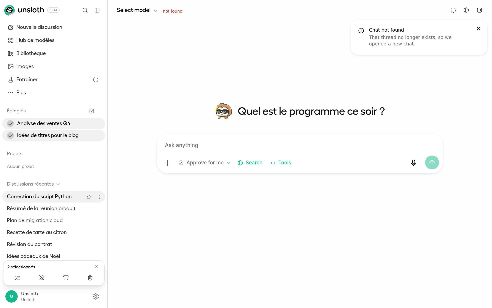

# Studio: discoverable, per-section sidebar multi-select

## Related
- Related to #7116 (multi-select delete in Recents). Bulk chat actions already landed in #7384 / #8745; this PR makes them discoverable rather than hidden behind `Cmd/Ctrl+Click` and the context menu.

## What changed

- Adds a checkbox toggle to the **Pinned** and **Recents** headers. Plain clicks then toggle rows, and a floating bar exposes select all, pin/unpin, archive, delete, and clear.
- Selection is scoped to the header that started it. Pinned never selects Recents and vice versa; opening a chat from the other section keeps the current selection.
- **Select all** is a toggle: a second click deselects the section. Pinned selections show **Unpin**.
- Bulk delete now uses the existing `deleteChatItems` batch path: one request for the whole selection instead of one call per chat.
- The Pinned title now uses `shell.navigation.pinned`, with translations added for every locale along with the new selection labels.

`selectionSection` already records the active section, and `handleProjectSelectionClick` accepts it, so adding the same mode to Projects later is mostly wiring a header toggle.

## Screenshots

Pinned selection, with checkboxes only in that section:

Select all toggled off:

Bulk delete confirmation:

Opening a Recents chat keeps the Pinned selection:

## Testing

`npm run typecheck`, `npm run i18n:check:strict`, sidebar tests, plus visual checks in light and dark mode.
