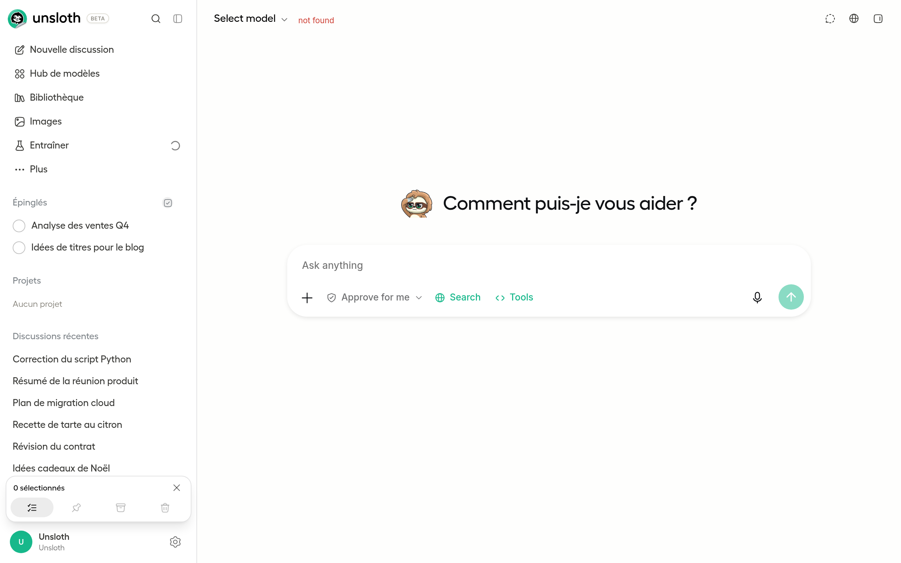

# Studio: surface the existing sidebar multi-select per section

## Why

The sidebar already supports multi-select through `Cmd/Ctrl+Click`, `Shift+Click`, and the row context menu, and bulk actions already exist. This PR only makes that discoverable: a checkbox in the **Pinned** and **Recents** headers starts a selection for that section, and a floating bar exposes the same bulk actions.

This builds on the merged bulk chat work in #8745, the sidebar selection from #8932, and the Recents "Delete all chats" action from #13779. It does not add a new destructive path or a separate management page; select-all is scoped to Pinned or Recents, while Delete all remains the global action in the menu.

## What changed

- Checkbox toggle in **Pinned** and **Recents**: plain clicks then toggle rows, and the floating bar exposes select all, pin/unpin, archive, delete, and clear.
- Selection is scoped to the header that started it. Opening a chat from the other section keeps the current selection.
- **Select all** toggles off on a second click. Pinned selections show **Unpin**.
- Bulk delete uses the existing `deleteChatItems` batch path: one request for the whole selection instead of one per chat.
- The Pinned title now uses `shell.navigation.pinned`, with all new labels translated in every locale.

`selectionSection` already records the active section, so the same mode can be extended to Projects later without reworking the selection model.

## Screenshots

Pinned selection, with checkboxes only in that section:

Select all toggled off:

Bulk delete confirmation:

Opening a Recents chat keeps the Pinned selection:

## Testing

`npm run typecheck`, `npm run i18n:check:strict`, sidebar tests, plus visual checks in light and dark mode.
